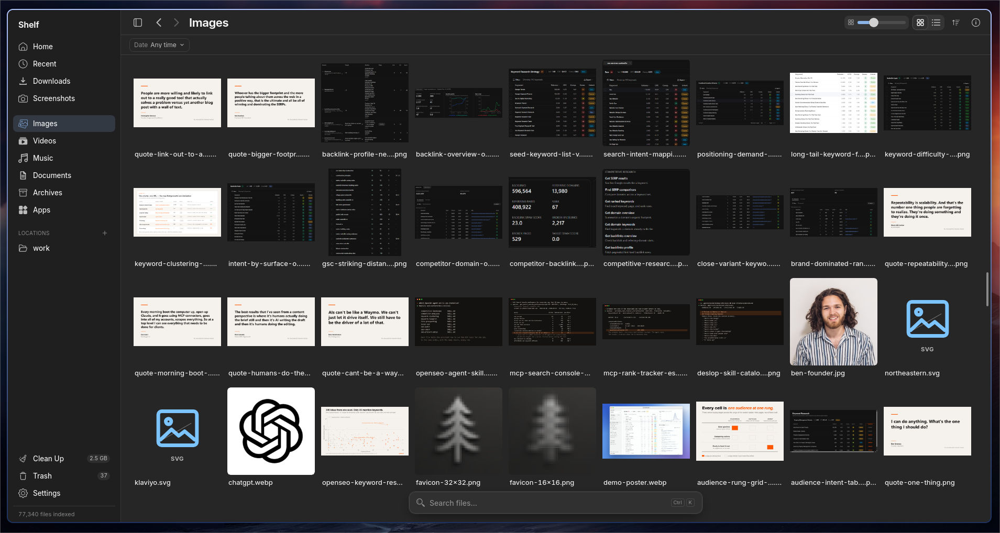
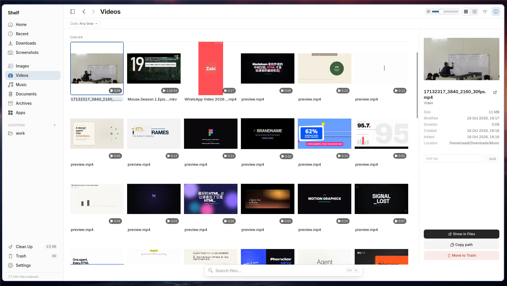
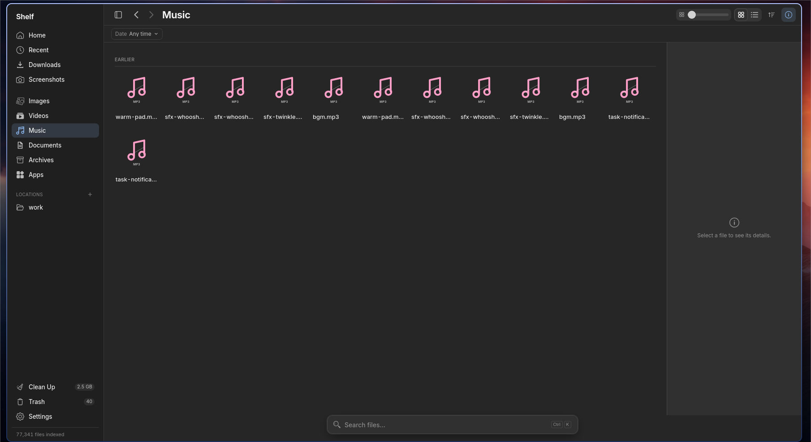
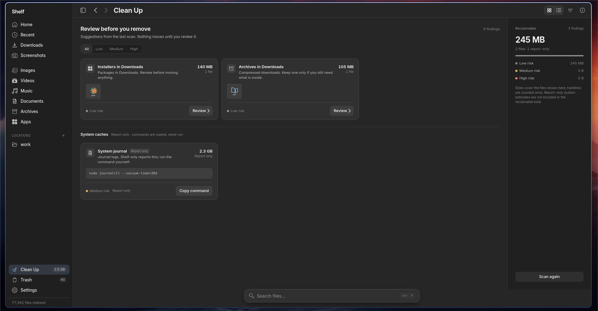
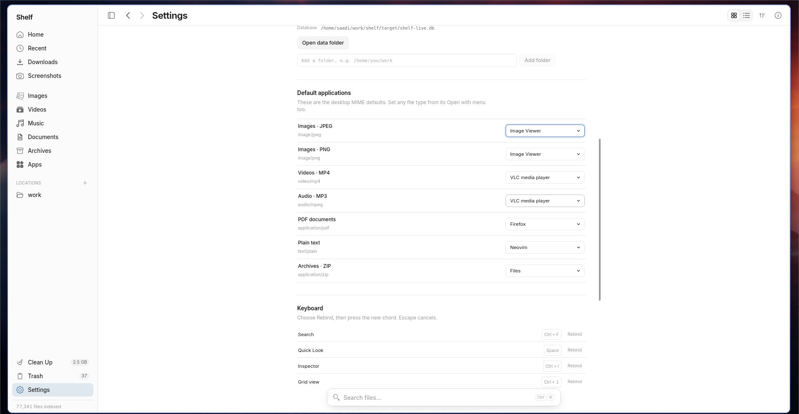

# Shelf

Local-first file intelligence for Linux. Shelf indexes your home folder, shows
it as a thumbnail grid or list, searches it with plain English, and moves files
to the Trash safely.

Rust workspace + Tauri 2 + Svelte 5. The core is UI-free: everything the UI can
do is reachable from the `shelf` CLI.

## Screenshots

| Downloads | Videos |
|---|---|
|  |  |

| Music | Cleanup |
|---|---|
|  |  |



## Status

v0.1 scaffold. Working today:

- SQLite index (WAL) with schema versioning; FTS5 trigram search over filenames.
- Background full scan + `notify` watcher, with cache/build/`node_modules` exclusions.
- Natural-language parser: kinds, extensions, dates, sizes, sources, places,
  with explainable chips.
- Grid and list views, virtualized, with a Quick Look overlay and inspector.
- Native app icons from desktop entries/icon themes, semantic file-type fallbacks, image/video/PDF/audio-cover thumbnails, PDF first-page covers, Markdown/text card snippets, video duration, cached on disk.
- Right-click menu with Open, Open with, Show in folder, Copy path, Rename,
  Move/Copy to and Move to Trash; F2 renames.
- Move to Trash through the freedesktop spec, receipt-backed Undo, permanent
  purge, system Trash aggregation, Show in Files, terminal launch and tags via
  `user.xdg.tags`.
- Clean Up findings from the index with review, dry run, measured system cache
  sizes and truncation notices.
- Duplicate detection by size and SHA-256 content hash.
- User-defined Locations, breadcrumbs, folder rails, folder context menus and
  app-codebase detection.
- Plain-English search with tag, extension, year and size-range filters.
- Theme switching, text size, user theme file (`~/.config/shelf/theme.json`)
  and local tracking controls.
- `shelf` CLI: `index`, `query`, `explain`, `stats`, `trash`, `duplicates`,
  `cleanup`, `receipts`, `undo`, `tags`, `open`, `apps`, `terminal`, `copy`,
  `move`, `default`, `thumb`, `text`, `reveal`, `clear-activity`.

Not yet: OCR/document-text search, tray icon, external daemon, timeline view
and release packaging. See `product-plan.md` for the version slots.

## Requirements

- Linux with WebKitGTK 4.1 and GTK 3 (Tauri 2 runtime).
- Rust 1.90 or newer (`rust-toolchain.toml` pins stable).
- Node 24 and pnpm 11.
- Optional: `ffmpeg` and `pdftoppm` for video and PDF previews. Everything else
  falls back to an extension badge.

## Build and run

```sh
cargo fetch
pnpm --dir app/ui install

# Desktop app with hot reload
pnpm --dir app/ui tauri dev

# Desktop app against the built frontend
pnpm --dir app/ui build
cargo run -p shelf-app --features custom-protocol

# CLI
cargo run -p shelf-cli -- index ~/Downloads
cargo run -p shelf-cli -- query "pdf in august over 5 MB"
cargo run -p shelf-cli -- explain "screenshots last week"
cargo run -p shelf-cli -- stats
cargo run -p shelf-cli -- open ~/Downloads/invoice.pdf
cargo run -p shelf-cli -- apps ~/Downloads/clip.mp4
cargo run -p shelf-cli -- thumb ~/Downloads/clip.mp4 --out preview.png
```

The index lives at `$XDG_DATA_HOME/shelf/index.db` (`~/.local/share/shelf` by
default). Override it with `SHELF_DB`.

## Development environment variables

| Variable | Effect |
|---|---|
| `SHELF_DB` | Index path, for a scratch database. |
| `SHELF_INDEX_ROOTS` | Colon-separated roots to scan/watch instead of `$HOME`. |
| `SHELF_AUTOINDEX=0` | Do not start the first-run scan automatically. |

Application directories (`~/Applications`, XDG application directories,
Flatpak and Snap exports) are added automatically even when
`SHELF_INDEX_ROOTS` is set. Custom folders can be added under
**Settings → Indexed folders** or as sidebar Locations.

The theme is a single JSON file at `~/.config/shelf/theme.json`. It controls
light/dark colors, fonts and shared radii; edit it and use **Settings →
Appearance → Reload**. The file is created on first launch.

## Layout

| Path | Contents |
|---|---|
| `crates/core` | Schema, migrations, `Store`, FTS5, types, cursor pagination. |
| `crates/query` | Parser → `Filter` + chips. Pure, table-tested with 100 queries. |
| `crates/watcher` | Debounced watching and full scans, exclusion rules. |
| `crates/media` | Kind/screenshot detection, freedesktop thumbnails, generation. |
| `crates/platform` | Trash, origin/tag xattrs, D-Bus FileManager1 and OpenURI. |
| `crates/cli` | The `shelf` binary. |
| `app/src-tauri` | Tauri adapter: typed commands, event coalescing, `thumb://`. |
| `app/ui` | Svelte 5 + TypeScript + Vite frontend. |

Design tokens and interaction rules live in `ui-ux.md`. Architecture, budgets
and roadmap live in `product-plan.md`. Contributor commands live in `AGENTS.md`.

## Releases

Draft bundles are built by the tag-driven release workflow. Downloads and
checksums will be listed under
[Releases](https://github.com/codersaadi/shelf/releases) once the first preview
is published.

## Platform support

Linux only today: GTK 3 + WebKitGTK 4.1, X11 or Wayland. Bundles are AppImage,
`.deb` and `.rpm`; Flatpak is the next packaging target. Windows and macOS are
not supported because the platform layer depends on freedesktop Trash, Linux
xattrs and D-Bus.

See `docs/distribution.md` for release channels and `docs/performance.md` for
memory/performance measurement.

## License

Shelf is licensed under the [Apache License 2.0](LICENSE-APACHE).

## Checks

```sh
cargo fmt --all --check
cargo clippy --workspace --all-targets -- -D warnings
cargo test --workspace
pnpm --dir app/ui check
pnpm --dir app/ui build
```
